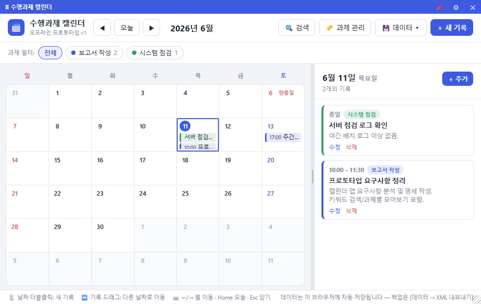

# 📖 수행과제 캘린더 사용 설명서

> 처음 쓰는 분을 위한 기능별 사용법, 키보드 단축키, 문제 해결을 담았습니다. 빌드/배포는 [DEPLOY.md](DEPLOY.md), 내보내기 XML 포맷은 [SPEC.md](SPEC.md) §3을 보세요.
>
> **v0.18.0부터 기록은 이 PC가 아니라 사내 서버 DB에 저장됩니다.** 어느 자리에서 로그인해도 같은 캘린더가 뜨는 대신, **서버에 연결되어야 동작**합니다. 옛 버전에서 쓰던 기록은 [13. 데이터·백업·이관](#13-데이터백업이관)의 절차로 **한 번만** 옮기면 됩니다.

---

## 목차
1. [시작하기](#1-시작하기)
2. [화면 구성](#2-화면-구성)
3. [일정·할 일 등록 (빠른 캡처)](#3-일정할-일-등록-빠른-캡처)
4. [수정·삭제](#4-수정삭제)
5. [기간·반복 일정](#5-기간반복-일정)
6. [할 일(TODO)](#6-할-일todo)
7. [Git 커밋 기능(삭제됨)](#7-git-커밋-기능삭제됨)
8. [보고서 만들기(근태 탭)](#8-보고서-만들기)
9. [검색·과제 필터](#9-검색과제-필터)
10. [창 모드·트레이·크기 조절](#10-창-모드트레이크기-조절)
11. [테마(다크 모드)](#11-테마다크-모드)
12. [키보드 단축키](#12-키보드-단축키)
13. [데이터·백업·이관](#13-데이터백업이관)
14. [문제 해결(FAQ)](#14-문제-해결faq)

---

## 1. 시작하기

- **위젯(권장)**: 배포된 `수행과제캘린더.exe`를 실행하면 바탕화면에 위젯이 뜹니다. `Win+D`로 바탕화면을 봐도 함께 보입니다.
- **회사 계정으로 로그인**: 처음 켜면 로그인 화면이 뜹니다. **주간보고(netcus)에 쓰는 그 계정**입니다. 회사 **이메일 주소가 아닙니다**(`phmin@netcus.com`이면 `phmin`). 한 번 로그인하면 세션이 유지됩니다.
- **브라우저(체험)**: `task-calendar-prototype.html`을 더블클릭하면 Edge에서 캘린더·보고서 초안은 그대로 동작합니다. 단 **서버 DB에 붙지 않아** 데이터는 그 브라우저의 localStorage에만 남고 위젯과 공유되지 않으며, 로그인, 회사 보고 전송, 알림은 없습니다.
- 첫 실행 때 **자동 시작(로그인 시 실행)** 여부를 1회 물어봅니다. 나중에 ⚙(설정)에서 변경할 수 있습니다.
- **과제(카테고리) 먼저 만들기**: 상단바 `🏷️ 내 과제`(좁은 창에서는 `⋯ → 내 과제`)에서 "보고서 작성", "시스템 점검"처럼 수행 과제를 만들고 색을 지정하세요. 사업부 **공식 과제**는 서버 DB의 마스터에서 골라 씁니다.
- **옛 버전에서 넘어왔다면**: 캘린더가 비어 보이면 그건 데이터가 사라진 게 아니라 **아직 안 옮긴 것**입니다. [13. 데이터·백업·이관](#13-데이터백업이관)을 보세요.

## 2. 화면 구성

| 영역 | 설명 |
|---|---|
| **상단바(좌)** | `◀ 오늘 ▶` 월 이동, 연·월 제목(클릭 시 점프), `[월간 \| 주간]`, `⚲ 보기`(달력에 보일 기록 종류와 과제) |
| **상단바(우)** | `🔍 검색`, `👥 다른 사람 일정`, `🏷️ 내 과제`, `🐞 문의`(버그·개선 접수처), `👤 사용자 정보`(신원, 권한, 로그아웃), `🎨 모양`(테마, 위젯 투명도), `? 도움말`, `⋯ 더보기`(설정, 업데이트 확인, XML 내보내기/가져오기, 과제 데이터 내보내기, 전체 초기화, 관리자는 `⚙ 관리`) |
| **탭 줄** | `[개인 \| 과제 \| 근태]`. 개인은 내 달력, 과제는 과제 공용 일정과 관심 과제, 근태는 일간, 주간, 취합 보고 |
| **월 그리드(좌)** | 주말 옅은 틴트, 오늘은 얇은 링, 선택 날짜는 강조. 칸 안은 여러 날 막대, 그날 일정(시간순), 그날 할 일 순서이고 넘치면 `+n개 더보기`. 일정=채운 막대 / 할 일=속 빈 링 칩 / 시간 일정=색점+시각 |
| **날짜 패널(우)** | 고른 날짜만. 머리(날짜, `＋ 추가`), 일정 n(카드)과 할 일 n(남은 개수/전체) 두 묶음, 맨 아래 `밀린 할 일` 한 줄 |
| **분할바** | 좌/우 너비 드래그 조절 (좁은 폭에선 우측이 하단 시트로) |

> 창이 좁아지면 `검색`, `다른 사람 일정`, `내 과제`, `문의`, `사용자 정보`가 `⋯ 더보기` 안으로 접힙니다. 사라진 게 아닙니다.
> (2026-11-03 바뀜: 상단 `📄 보고서`와 `＋ 새 기록` 단추, 우측 패널의 `[일정 상세 | 할 일]` 탭, 과제 필터 칩 줄은 없어졌습니다.)
> 묶음 머리(일정, 할 일)는 패널을 스크롤해도 위에 붙어 보입니다. 붙은 머리를 누르면 그 묶음 처음으로 가고, 제자리일 때 누르면 접습니다. 묶음마다 5개가 먼저 보이고 `n개 더 보기`로 펼치고 `줄이기`로 접습니다. 비모달 팝업은 머리 줄 오른쪽 `×`로 닫습니다.
> 화면 위에 **`DB 연결됨 — 변경은 서버에 저장됩니다`** 같은 띠가 보이면, 지금 무엇을 보고 있고 저장이 되는 상태인지 알려 주는 출처 배지입니다.

## 3. 일정·할 일 등록 (빠른 캡처)

모든 등록은 **입력 창** 한 곳으로 모입니다. 여는 방법:
- 날짜 칸 **더블클릭**
- 날짜 패널 머리의 **＋ 추가**

(2026-11-03 바뀜: 상단 `＋ 새 기록` 단추는 없어졌습니다. 보기가 할 일만이면 할 일로 열립니다.)

입력 창에서:
1. 위쪽 토글로 **일정 / 할 일** 선택
2. 제목 입력
3. 시작일, 종료일, 과제 지정(두 날짜가 다르면 여러 날 일정)
4. 종일 또는 시각, 미리알림, 반복, 장소, 메모(일정) 또는 중요, 메모(할 일). 모든 칸이 한 화면에 있습니다
5. **저장**

> 시간을 넣으려면 "종일" 체크를 끄면 시작/종료 시각 칸이 나타납니다. 시각은 한 칸에서 시와 분(5분 단위)을 함께 고릅니다.

## 4. 수정·삭제

- **수정**: 캘린더의 칩을 누르면 그 날짜가 골라지고 패널에서 그 항목이 강조됩니다. 패널 일정 카드의 **수정**(할 일은 제목)을 누르면 등록할 때와 같은 한 화면 입력 창이 편집 모드로 열립니다.
- **삭제**: 카드의 **삭제**. 삭제 후 토스트의 **실행 취소**로 되돌릴 수 있습니다.
- **반복 일정 삭제**: "이 날짜만"(건너뛰기) 또는 "전체 반복" 선택.

## 5. 기간·반복 일정

- **기간(여러 날)**: 입력 창에서 종료일을 시작일과 다르게 고릅니다. 캘린더에 **연속 막대**로 표시되고, 겹치는 막대는 서로 다른 줄(레인)에 고정됩니다.
- **반복**: 입력 창에서 반복(안 함, 매주, 매월)을 고릅니다. 예전에 정해 둔 격주나 횟수는 수정해도 그대로 남고 반복 칸 아래에 한 줄로 보입니다.
- 기간 일정은 막대를 드래그하면 시작·종료가 함께 이동(길이 보존)합니다.

## 6. 할 일(TODO)

- 날짜 패널의 **할 일** 묶음: 고른 날짜의 할 일. 중요한 것 먼저, 안 끝낸 것 먼저. 머리 숫자는 남은 개수/전체입니다.
- 체크박스로 완료 토글(끝낸 할 일은 줄을 그어 보임), 줄 끝 **★**로 중요 표시.
- 패널 맨 아래 **밀린 할 일**을 누르면 기한 지남, 기한 없음, 완료(처음엔 접힘)로 묶어 과제별로 봅니다. 날짜 있는 할 일을 누르면 그 날짜로 갑니다.
- 할 일만 보려면 **⚲ 보기**에서 기록 종류를 할 일로 고릅니다. (2026-11-03 바뀜: 할 일 탭과 "중요만" 단추는 없어졌습니다.)
- 기한이 있는 할 일은 **캘린더에 속 빈 링 칩**으로 표시되어 일정(채운 막대)과 모양으로 구분됩니다(색맹 안전).

## 7. Git 커밋 기능(삭제됨)

2026-10-26 에 Git, SVN 기능을 모두 지웠습니다. 우측 패널의 '커밋 내역' 탭, 커밋 불러오기, 과제 창의 저장소 경로와 작성자 칸, 보고서의 커밋 항목이 없어졌습니다. 이미 서버에 있던 커밋 기록도 일반 기록으로 바꾸지 않고 모두 지웠습니다(DB 구조 18). 옛 XML 파일을 가져와도 커밋 기록은 읽지 않습니다. 근거는 [docs/GIT-SVN-REMOVAL.md](docs/GIT-SVN-REMOVAL.md).

## 8. 보고서 만들기

보고는 달력 위 **근태** 탭에서 합니다(2026-11-03 바뀜: 상단 `📄 보고서` 단추와 보고서 창은 없어졌습니다). 위젯에서는 일간과 주간 편집이 따로 뜨는 근태 창으로 열립니다.

1. **일간**: 날짜를 고르고 과제별 블록에 시간과 내용을 적습니다. 가져오기는 [캘린더](그날 일정과 할 일, 제목은 1수준, 설명은 2수준)와 [이전 보고]입니다. **보고**를 누르면 회사 일간보고에 보내고, 회사에서 되읽어 확인된 뒤에만 서버 DB 에 남깁니다. 보고한 날은 **인트라넷에서 확인**으로 회사 근태관리 달력을 엽니다.
2. **주간**: 첫 화면은 목록입니다(기간 고르기, 찾기, 20건씩). **작성**이나 행을 누르면 편집 화면(진행사항, 과제투입시간, 차주계획, 회의내용)입니다. [← 이번 주 일간 보고]로 이 앱 일간 기록을 불러옵니다. **보고**는 회사 주간 폼을 채우고 **임시저장까지** 한 뒤 되읽어 확인하고 창을 닫습니다. 같은 기간 글이 있으면 그 글을 고칩니다. **제출은 인트라넷에서 직접** 합니다. 저장한 주는 **인트라넷에서 확인**으로 그 글을 엽니다.
3. **취합**: 기간과 내용 출처(**캘린더 기록** = 이 앱으로 쓴 주간보고, **인트라넷 주간** = 회사 주간보고)를 고르고 **읽어 오기**를 누릅니다. 오른쪽 위 `[과제별 글 | 월간 보고 문서]`에서 과제별 글은 **복사**, 월간 보고 문서는 **문서 설정** 띠(계획 기간, 작성일, 과제와 그림, 기타 표)를 정해 **DOCX 저장**합니다.

- **수준과 문단 모양**(일간 본문과 메모, 주간 진행사항, 차주계획, 회의내용): 한글 개요처럼 `Tab`(한 수준 증가), `Alt+←/→`, `Alt+0~7`(본문 또는 그 수준), `Shift+Enter`(맨 앞 본문 줄)로 수준을 바꿉니다. 수준마다 들여쓰기와 머리기호는 머리 줄 도구의 **문단 모양** 창에서 정하고 계정별로 이 PC 에 기억됩니다. 표와 꼭 맞는 줄만 수준으로 읽고, 직접 쓴 다른 줄은 앱이 고치지 않습니다.
- 쓰던 글은 이 PC 에 자동 임시 저장되고, 회사와 DB 가 모두 성공하면 지웁니다.

## 9. 검색·과제 필터

- **검색**(상단 돋보기): 제목, 메모, 과제로 전역 검색, 날짜별 그룹 + 하이라이트. 클릭하면 그 날짜로 이동.
- **⚲ 보기**(달력 위 `[월간 | 주간]` 옆): "달력에 보일 것" 팝업에서 기록 종류 `[전체 | 일정 | 할 일]`과 과제(여러 개, 찾기, 전체 선택/해제)를 고릅니다. `[처음대로]`로 되돌리고, 고른 보기는 계정별로 이 PC 에 기억됩니다. (2026-11-03 바뀜: 과제 필터 칩 줄 대신 이 단추 하나)
- **과제 탭**: 공식 과제의 공용 일정을 봅니다. 왼쪽 목록은 `[내 과제 | 관심 과제]` 탭이고 달력은 두 탭에서 체크한 과제를 합쳐 보여 줍니다. **관심 과제 추가**로 내 과제가 아닌 공식 과제도 읽기 전용으로 더합니다(50개까지, 참여자로 거르기). 관심 과제는 색 없이 회색 점선으로 보이고, 고치기와 개인 일정에 등록은 참여자만 합니다.

## 10. 창 모드·트레이·크기 조절

- **창 모드**: `⚙ → 트레이 아이콘 사용`
  - **켜기** = 일반 앱 창(작업표시줄·`Alt+Tab`에 표시, ✕ = 트레이로 숨김).
  - **끄기** = 바탕화면 최하위 위젯(작업표시줄 제외, 항상 바탕화면 레이어).
- **맨 앞에 띄우기**: 크기와 위치는 그대로 두고 다른 창 위에만 띄웁니다(v0.19.1 에서 옛 '넓게 보기' 🔳 를 대신함). 창 버튼(최소화, 최대화, 닫기)도 있습니다.
- **이동/크기**: 📌(고정) 해제 후 상단 바 드래그로 이동, 가장자리·모서리(8방향) 드래그로 크기 조절. ⚙에서 크기 프리셋과 모니터 이동.

## 11. 테마(다크 모드)

상단바 **🎨(모양)** 메뉴에서 고릅니다. **시스템, 라이트, 다크, 포레스트, 세피아, 고대비** 6종이 있습니다. 기본값 **시스템**은 Windows 테마(라이트/다크)를 따라 자동 전환합니다. 모든 아이콘이 단색(currentColor)이라 어느 테마에서도 자연스럽게 보입니다.

같은 메뉴 아래에 **위젯 투명도** 슬라이더가 있습니다(위젯 모드 전용). 반투명으로 해도 모달, 토스트, 알림 창은 불투명하게 유지됩니다.

## 12. 키보드 단축키

마우스 없이 전체 조작이 가능합니다.

| 상황 | 키 | 동작 |
|---|---|---|
| 월 그리드(셀 포커스) | `←` / `→` | 하루 이전/다음 |
| | `↑` / `↓` | 한 주 이전/다음 |
| | `PageUp` / `PageDown` | 한 달 이전/다음 |
| | `Home` | 오늘로 |
| | `Enter` / `Space` | 그 날짜 선택 |
| 전역(그리드 밖) | `←` / `→` 또는 `PageUp` / `PageDown` | 월 이동 |
| | `Home` | 오늘 |
| 근태 본문(작성 보조) | `Tab` | 한 수준 증가 |
| | `Alt+←` / `Alt+→` | 한 수준 감소/증가 |
| | `Alt+0` ~ `Alt+7` | 본문, 또는 그 수준으로 바로(숫자 줄 키) |
| | `Enter` / `Shift+Enter` | 수준 줄이면 같은 수준 새 항목(아니면 빈 줄) / 맨 앞 본문 줄 |
| 모달 | `Tab` / `Shift+Tab` | 포커스 순환(트랩) |
| | `Esc` | 닫기 (모달, 메뉴, 하단시트 순) |
| 입력 | `Enter` | 입력 창 저장 |

> 모달을 닫으면 포커스가 그것을 연 버튼으로 자동 복원됩니다. 접근성: WCAG AA 대비, 가시 포커스 링, 화면 낭독기용 ARIA, `prefers-reduced-motion` 존중.

## 13. 데이터·백업·이관

### 어디에 저장되나

- **일정, 할 일, 과제, 공수, 근태, 보고 기록, 회사 공용 회의실 목록**: **사내 서버 MySQL**(v0.18.0부터). 어느 자리 PC에서 로그인해도 같은 데이터가 뜹니다. 백업은 서버 쪽 일이라 사용자가 챙길 것은 없습니다(배포 시 관리자가 주간 백업을 등록합니다).
- **이 PC에만 남는 것**: 창 위치·크기(`widget.settings.json`), 알림 확인 이력(`reminders.json`), 로그인 세션과 회사 보고 자격증명(암호화). 경로는 `%APPDATA%\TaskCalendar\`.
- **로컬 캐시는 없습니다.** 서버에 못 붙으면 기록이 표시되지 않습니다. 잘못된 옛 데이터를 보여 주는 것보다 안 보여 주는 쪽을 택했습니다.

### 옛 버전 기록 옮기기 (한 번만)

v0.17.1까지는 `%APPDATA%\TaskCalendar\data.xml`에 저장했습니다. **자동으로 옮기지 않습니다.** 확인하고 직접 올리시라고 이렇게 뒀습니다.

1. 업데이트 후 캘린더가 비어 있으면 화면 위에 **"이전 버전에서 쓰던 기록이 있다면 XML 파일에서 가져올 수 있습니다"** 안내(**미이관 표시등**)가 뜹니다.
2. 그 옆의 **XML 가져오기…** 를 누르면 파일창이 **데이터 폴더에서 바로** 열립니다(숨은 경로를 손으로 찾을 필요 없음).
3. `data.xml`을 고르면 **미리보기**(파일 내용 vs 현재 데이터)가 뜹니다. **교체**를 누르고 확인 창에서 한 번 더 누르면 현재 데이터를 모두 지우고 파일 내용 그대로 서버에 올라갑니다. 가져오기는 교체 하나뿐입니다(병합은 2026-10-07에 없앴습니다).
4. 원본 파일은 지우지 않습니다. 데이터 폴더에서 고른 파일이면 `data.xml.migrated-<날짜>`로 **이름만 바뀝니다**(대조용 원본은 그대로 남습니다). 안내는 `⋯ → XML 가져오기…`로도 언제든 다시 열 수 있습니다.

> 신규 사용자에게 빈 화면은 정상입니다. 옮길 것이 없으면 그냥 쓰면 됩니다.

### 내보내기(반출·개인 백업)

- `⋯ → XML 내보내기`: 지금 데이터를 `taskCalendar` XML v1 파일로 저장합니다(포맷은 [SPEC.md](SPEC.md) §3). 저장 형식이 아니라 **반출 형식**입니다.
- `⋯ → 과제 데이터 내보내기…`: 과제 하나와 기간을 골라 그 안의 일정과 할 일을 폴더(`과제데이터_<과제>_<시작>_<끝>`) 안의 **`calendar/캘린더.md`** 로 뽑습니다(요약 파일 `내보내기_요약.txt` 가 함께 생깁니다)(위젯 전용, LLM 입력이나 실적 정리용).

## 14. 문제 해결(FAQ)

- **캘린더가 비어 있어요 / 내 기록이 사라졌어요**: 두 가지 중 하나입니다. ① **아직 안 옮긴 경우**: 화면 위 안내에서 [13. 옛 버전 기록 옮기기](#옛-버전-기록-옮기기-한-번만)를 진행하세요. ② **서버에 못 붙은 경우**: "DB에서 캘린더를 읽지 못했습니다" 안내가 함께 뜹니다. 아래 항목을 보세요.
- **"DB에서 캘린더를 읽지 못했습니다. 위젯을 다시 시작하세요"**: 아침에 PC가 사내망보다 먼저 뜨면 날 수 있습니다. 화면의 **[다시 시도]** 를 누르면 즉시 재조회하고, 그냥 두어도 **15, 30, 60초 간격으로 자동 재시도**합니다(위젯을 껐다 켜도 됩니다). 계속 실패하면 사내망 연결과 서버 상태를 확인하세요.
- **오늘 알림이 안 울렸어요**: 알림은 **서버에서 읽어 온 일정**을 대상으로만 돕니다. 그날 서버에 못 붙었다면 알림도 울리지 않습니다(의도된 동작입니다. 로컬에 알림표를 따로 두면 다른 PC에서 지운 일정이 여기서 울리게 됩니다).
- **로그인이 안 돼요**: **주간보고(netcus)와 같은 계정**입니다. 회사 **이메일 주소가 아닙니다.** 이메일을 넣으면 앱이 쓸 ID를 알려 줍니다. 그래도 안 되면 그 계정이 과제 DB(`app_user`)에 등록돼 있는지 관리자에게 확인하세요.
- **저장이 안 되고 "권한이 없습니다"가 떠요**: 공식 과제 편집 권한은 **로그인 계정**(`app_user.edit_role`)으로 정해집니다. 공용 관리자 비밀번호는 v0.17.0에서 폐지됐습니다. 👤 사용자 정보에서 지금 내 권한을 확인할 수 있습니다.
- **위젯이 안 떠요 / WebView2 오류**: Microsoft Edge WebView2 런타임이 필요합니다(Windows 11 기본 내장). 없으면 설치 후 재실행.
- **새 버전을 배포했는데 안 바뀌어요**: 로그인 자동시작이 옛 빌드 경로를 가리켰던 문제인데, **자동시작 경로는 시작할 때 위젯이 스스로 고칩니다**(새 exe를 한 번 실행하면 등록값이 그 경로로 바뀝니다). 그래도 옛 화면이 뜨면 실행 중인 옛 위젯을 끄고 새 exe를 실행하세요.
- **글자가 작아요/좁아요**: 가장자리 드래그로 창을 키우거나 ⚙ 크기 프리셋을 쓰세요. 좁은 폭에선 우측 패널이 하단 시트로 바뀝니다.
- **보고서 단추가 없어요**: 2026-11-03 부터 보고는 달력 위 **근태** 탭(일간, 주간, 취합)에서 합니다. 기간 취합과 월간 보고는 근태 탭 **취합**입니다.
